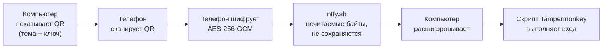
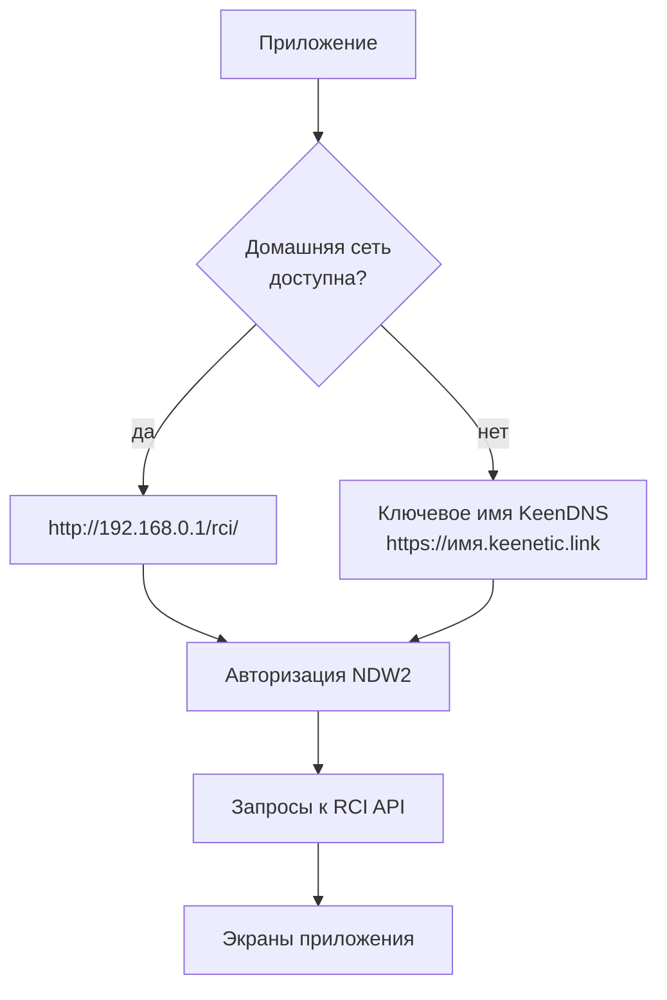

<div align="center">

# 📡 Keenetic Giga

**Неофициальное Android-приложение для управления роутером Keenetic Giga через RCI API.**


[Что это](#-что-это) • [Возможности](#-возможности) • [Сканировать QR](#-сканировать-qr) • [Установка](#-установка) • [FAQ](#-faq)

</div>

---

## 📖 Что это

Приложение повторяет интерфейс **KeeneticOS** и обращается к роутеру напрямую по RCI API
(`/rci/`) — никаких облачных посредников: данные идут с телефона на роутер. Собрано на
**Expo SDK 57 / React Native 0.86**, язык интерфейса — русский, темы светлая и тёмная.

> [!NOTE]
> Приложение **не связано с компанией Keenetic** и не является её официальным продуктом.
> «Keenetic» и «Keenetic Giga» — товарные знаки их владельцев. Используйте на свой риск.

> [!IMPORTANT]
> Учётные данные и адреса роутера **не хранятся в репозитории**. Логин, пароль и адреса вводятся
> в приложении и остаются только на устройстве.

---

## 🔗 Сканировать QR

**Сразу к делу — то, что обычно ищут:**

| Что | Где |
| :--- | :--- |
| 🌐 **Страница связки** (показать QR-код) | **<https://notyeamu.github.io/KeeneticGigaApp/pair.html>** |
| 📜 **Скрипт для Tampermonkey** | **<https://notyeamu.github.io/KeeneticGigaApp/keenetic-pair.user.js>** |
| 📂 Исходники страницы связки | [`docs/pair.html`](docs/pair.html) |
| 📂 Исходники скрипта | [`docs/keenetic-pair.user.js`](docs/keenetic-pair.user.js) |
| 🗂 Все вспомогательные страницы | <https://notyeamu.github.io/KeeneticGigaApp/> |

**Как войти в роутер на компьютере, не набирая пароль:**

1. Откройте **страницу связки** в браузере **на компьютере** — она покажет QR-код.
2. В приложении на телефоне: **Настройки → Сканировать QR**.
3. Наведите камеру телефона на код. Данные уйдут на компьютер, там откроется роутер и войдёт сам.

> [!TIP]
> Код на странице связки обновляется сам — под ним идёт полоса с обратным отсчётом. Если камера
> не берёт мелкий код, нажмите кнопку **увеличения**: он развернётся на весь экран.

> [!NOTE]
> Для автоматического входа на компьютере **нужен Tampermonkey** со скриптом. Без него страница
> роутера откроется, но данные в неё не передадутся — пароль придётся ввести вручную. Скрипт можно
> **скачать файлом** прямо из приложения или скопировать ссылку на него.

> [!IMPORTANT]
> Со скриптом на странице входа роутера появляется ссылка **«Сканировать QR»** — рядом
> с «Не могу войти» и «Центр поддержки». Она открывает эту же страницу, так что приложение
> под рукой держать не обязательно.

<details>
<summary><b>Почему QR показывает компьютер, а не телефон?</b></summary>

<br>

Страница роутера открывается по обычному `http://` на локальном адресе. Такой адрес браузер
**не считает защищённым контекстом** — доступ к камере там не даётся вообще. Значит, снять код
на компьютере физически нечем: камера есть только у телефона. Поэтому код показывает компьютер,
а читает его телефон.

Данные роутера при этом едут в обратную сторону: телефон шифрует их ключом из считанного кода
и передаёт через публичную очередь [`ntfy.sh`](https://ntfy.sh), где их забирает страница
на компьютере.

</details>

<details>
<summary><b>Насколько это безопасно?</b></summary>

<br>

**Алгоритм:**



- **Пароль шифруется** алгоритмом AES-256-GCM ключом, который лежит только в QR-коде.
  Кто видит код — видит и ключ, поэтому держите код в секрете от посторонних глаз.
- **Посредник ntfy.sh видит только шифртекст** — прочитать его без ключа невозможно.
- **Сообщение не сохраняется** на сервере: оно помечается `cache: "no"`, поэтому доставляется
  подписчику и сразу удаляется. Подтверждено проверкой: у такого сообщения нет срока хранения.
- **Подделка отвергается**: GCM-тег не даст незаметно изменить содержимое.
- **Каждый код — одноразовый**: при обновлении меняются и тема, и ключ.
- Скрипт принимает данные **только от страницы связки** — сообщение с чужого сайта отклоняется.

</details>

---

## ✨ Возможности

- 🔹 **Мониторинг** — системный монитор, монитор трафика, монитор Wi-Fi: живые данные с роутера.
- 🔹 **Кабель Ethernet** — подключения провайдера, расписание и приоритет, порты и VLAN'ы,
  параметры IPv4/IPv6, требования провайдера, PPPoE/PPTP/L2TP, 802.1x и Ping Check.
- 🔹 **Управление роутером** — клиенты, Wi-Fi, гостевые сети, сегменты, фильтры, маршрутизация,
  проброс портов: всё во вкладке «Раздел».
- 🔹 **Защита адреса** — адрес роутера в настройках скрыт анимированным блюром: касание
  показывает его, долгое нажатие копирует.
- 🔹 **Свой стек настроек** — обслуживание роутера (прошивка, резервная копия, диагностика),
  тема, язык, вибрация. Страницы из настроек открываются внутри настроек.
- 🔹 **Обновление приложения** прямо из приложения: скачивание APK и запуск системного установщика,
  плюс значок у пункта «Обновление системы», когда версия в репозитории новее.
- 🔹 **Сканировать QR** — вход в роутер на компьютере по коду с телефона,
  см. [раздел выше](#-сканировать-qr).

---

## ⚙️ Как это работает



**Авторизация NDW2** (`x-ndw2-interactive`) выполняется в нативном модуле
[`modules/digest-http`](modules/digest-http) на Kotlin/OkHttp:

1. `GET /auth` без авторизации → `401` и заголовки `X-NDM-Realm`, `X-NDM-Challenge` плюс сессионная кука.
2. `md5hex = MD5("логин:realm:пароль")`, затем `ответ = SHA256(challenge + md5hex)` — обе величины
   шестнадцатеричными строками в нижнем регистре.
3. `POST /auth` с JSON `{login, password: ответ}` и той же кукой.

Имя сессионной куки роутер выбирает случайно, поэтому используется настоящий `CookieJar`, а не
захардкоженное имя. Сессия живёт 300 секунд и продлевается каждым запросом.

---

## 📦 Требования

| Компонент | Версия / назначение |
| :--- | :--- |
| Android | 7.0 и новее (сборка под `arm64-v8a`) |
| Роутер | Keenetic Giga с прошивкой, поддерживающей RCI API и схему NDW2 |
| Node.js | 22 (для локальной сборки) |
| JDK | 21 (собирается в CI) |
| Expo SDK | 57.0.7 |
| React Native | 0.86.0 |
| Сеть | Домашняя сеть роутера или ключевое имя KeenDNS для доступа извне |

---

## 🚀 Установка

**1.** Скачайте APK на странице [**Releases**](../../releases).

**2.** Установите его поверх прошлой версии — внутренний номер сборки растёт монотонно,
поэтому обновление проходит без удаления приложения.

**3.** На экране входа укажите адрес роутера, логин и пароль.

> [!TIP]
> Внешнюю ссылку (`https://имя.keenetic.link`) указывать не обязательно — она нужна только для
> входа не из дома. Без неё приложение работает в домашней сети.

<details>
<summary><b>Сборка из исходников</b></summary>

<br>

```bash
git clone https://github.com/NOTyeamu/KeeneticGigaApp.git
cd KeeneticGigaApp
npm install

npx tsc --noEmit                                  # проверка типов
npx expo prebuild --platform android --clean      # генерация нативного проекта
npm run android                                   # сборка и запуск на устройстве
```

Сборка релиза идёт в GitHub Actions — файл [`.github/workflows/release.yml`](.github/workflows/release.yml).
Workflow генерирует нативный проект, собирает release-APK и подписывает его.

</details>

<details>
<summary><b>Секреты для подписи релиза</b></summary>

<br>

| Секрет | Обязательный | Назначение |
| :--- | :--- | :--- |
| `ANDROID_KEYSTORE_B64` | нет | base64 от файла `.jks` |
| `ANDROID_KEYSTORE_PASSWORD` | нет | пароль хранилища и ключа (по умолчанию `keeneticgiga`) |
| `ANDROID_KEY_ALIAS` | нет | алиас ключа; если не задан — определяется по keystore |

Без `ANDROID_KEYSTORE_B64` workflow соберёт APK с временным ключом: поставить его можно, а обновить
им уже установленное приложение — нет.

</details>

---

## 🕹 Использование

### Разделы приложения

| Раздел | Что внутри |
| :--- | :--- |
| **Статус** | Системный монитор, монитор трафика, монитор Wi-Fi |
| **Интернет** | Кабель Ethernet, Mobile, Wireless ISP, другие подключения, приоритеты |
| **Мои сети и Wi-Fi** | Устройства, домашняя сеть, гостевая сеть, Wi-Fi система, точки доступа, сегменты |
| **Сетевые правила** | IntelliQoS, интернет-фильтры, межсетевой экран, проброс портов, маршрутизация, доменные имена |
| **Настройки** | Общие настройки, обновление системы, резервная копия, диагностика, вход с компьютера |

### Настройки и приватность

<details>
<summary><b>Скрытый адрес роутера</b></summary>

<br>

Публичная ссылка на роутер в настройках показывается под анимированным размытием.
**Касание** — показать адрес, **долгое нажатие** — скопировать. Рядом есть кнопка «Изменить»,
чтобы вписать другой адрес или удалить текущий.

</details>

<details>
<summary><b>Домашняя сеть и внешний доступ</b></summary>

<br>

Приложение сначала проверяет домашние адреса (сначала заданный, затем `my.keenetic.net`) и переходит
на внешнюю ссылку, только если домашняя сеть недоступна.

У `my.keenetic.net` есть публичная DNS-запись, поэтому ответ по нему вне дома ещё не означает, что
ответил роутер — приложение это проверяет отдельно.

Внешняя ссылка должна указывать **на сам роутер** (например `https://имя.keenetic.link`). Поддомены
с другими сервисами (скажем, Home Assistant) роутером не являются и отвечают `404` — приложение
скажет об этом прямо.

</details>

---

## 📁 Структура

```
KeeneticGigaApp/
├── .github/workflows/release.yml   сборка и публикация APK
├── docs/                           вспомогательные страницы (GitHub Pages)
│   ├── index.html                  список страниц
│   ├── pair.html                   страница связки: показывает QR-код
│   ├── keenetic-pair.user.js       скрипт для Tampermonkey
│   └── vendor/qrcode.js            библиотека QR (MIT), положена локально
├── modules/digest-http/            нативный модуль авторизации NDW2 (Kotlin/OkHttp)
├── plugins/                        конфиг-плагины Expo
├── src/
│   ├── components/                 UI-компоненты (карточки, формы, блюр, QR)
│   ├── context/                    Auth, Settings, Page
│   ├── data/sections.ts            дерево разделов и пункты обслуживания
│   ├── screens/pages/              24 страницы разделов и «Сканировать QR»
│   ├── lib/
│   │   ├── api.ts                  выбор адреса роутера, запросы
│   │   ├── digest.ts               обёртка над нативным модулем
│   │   ├── bytes.ts                UTF-8 и base64url вручную (в Hermes их нет)
│   │   ├── pairing.ts              шифрование и передача для входа с ПК
│   │   ├── script.ts               сохранение скрипта Tampermonkey файлом
│   │   └── version.ts              проверка обновлений через GitHub Releases
│   └── theme/colors.ts             палитры, шрифты, отступы
├── app.json                        конфигурация Expo
└── package.json
```

---

## ❓ FAQ

<details>
<summary><b>Скрипт для Tampermonkey не запускается на странице роутера</b></summary>

<br>

Проверьте строку подключения в заголовке скрипта. Дело в правилах Tampermonkey для `@match`:
подстановка `*` в нём допустима **только первым или единственным символом хоста**. Шаблон вида
`// @match http://192.168.*/*` недействителен — Tampermonkey молча его игнорирует, и скрипт
на странице роутера просто не появляется. Именно из-за этого он раньше не работал.

Поэтому домашние адреса продублированы двумя способами: явными `@match` (они работают наверняка)
и шаблонами `@include` (там подстановка допустима в любом месте адреса, что покрывает и другие
адреса подсети). Скрипт запускается, если совпало хотя бы одно правило.

```javascript
// @match        http://192.168.0.1/*
// @match        http://192.168.1.1/*
// @match        http://192.168.0.1:*/*
// @include      http://192.168.*/*
// @include      http://10.*/*
// @include      http://172.16.*/*
```

Схемы с полноценным именем хоста (`*.keenetic.link`) остались в `@match` — там ограничение
не мешает.

</details>

<details>
<summary><b>На компьютере окно роутера не открылось</b></summary>

<br>

Браузер блокирует всплывающие окна, открытые без нажатия. Разрешите их для страницы связки
и нажмите **«Открыть роутер»** — кнопка на странице для этого и предусмотрена.

</details>

<details>
<summary><b>«Роутер использует схему авторизации, которую приложение не поддерживает»</b></summary>

<br>

Такое сообщение означает, что в ответе не оказалось заголовков `X-NDM-Realm` и `X-NDM-Challenge`.
Чаще всего причина прозаичнее: по адресу отвечает не роутер. Проверьте, что внешняя ссылка ведёт
на сам роутер, а не на другой сервис (например, Home Assistant) — тот ответит `404`.

</details>

<details>
<summary><b>Не удаётся войти по внешней ссылке</b></summary>

<br>

Убедитесь, что имя KeenDNS включено в настройках роутера и что ссылка указывает на роутер.
Обновление приложения по этой ссылке не требуется: она нужна только для доступа к интерфейсу
извне дома.

</details>

<details>
<summary><b>Обновление не ставится поверх прошлой версии</b></summary>

<br>

Сборка подписана другим ключом. Обновление поверх установки возможно, только если APK подписан
тем же ключом, что и предыдущий. Проверьте, что в секретах репозитория задан `ANDROID_KEYSTORE_B64`
(см. раздел [Установка](#-установка)).

</details>

---

## 📝 Заметки

- Приложение не хранит историю и не отправляет данные в интернет: все запросы идут на ваш роутер,
  а проверка обновлений — обычный `GET` к публичным релизам GitHub без токена.
- Страница связки подключает библиотеку QR **из репозитория**, а не с CDN: она принимает пароль
  роутера, и подмена этого файла на чужом сервере увела бы пароль.
- Страницы на GitHub Pages публикуются из папки [`docs/`](docs) ветки `main`.

---

## 📄 Лицензия

[MIT](LICENSE) © 2026 NOTyeamu

<div align="center">

---

<sub>Нашли проблему? <a href="../../issues">Откройте issue</a> · ⚠️ Проект не связан с компанией Keenetic</sub>

</div>